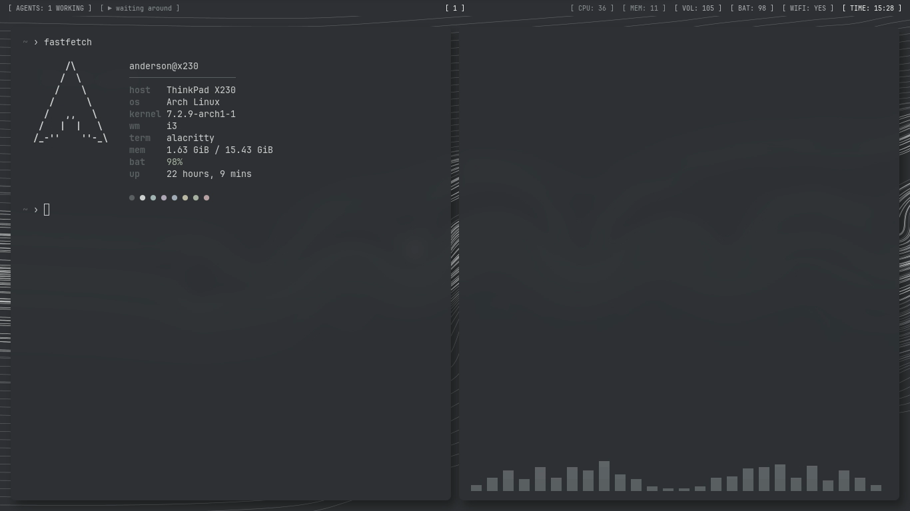
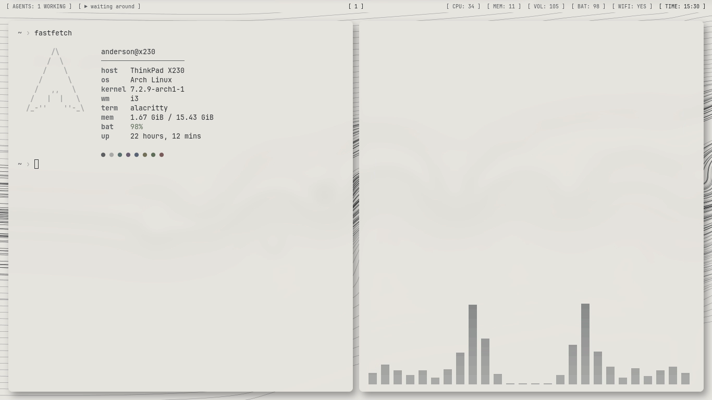

# graphite

a quiet i3 rice on a thinkpad x230 (2012). gray, calm, no icons.




## the machine

thinkpad x230 · i5-3320m · 16 gb · 1366×768 · arch linux · i3 4.25 on xorg · picom 13

## the look

| | dark | light |
|---|---|---|
| background | `#2f3134` | `#e8e6e1` |
| text | `#d0d1d2` | `#2f3134` |
| muted | `#8b8e92` | `#5e6064` |
| lines | `#5c5f63` | `#a9aaa8` |
| highlight | `#ececec` | `#2f3134` |

- font: jetbrains mono nerd font, everywhere
- windows: 1 px borders, 12 px gaps, 8 px rounded corners, soft shadows, small open/close animations
- every program reads the same two palettes; `alt t` copies one or the other into place and reloads what it can

## the wallpaper

streamlines of a turbulent flow behind a cylinder (a von kármán vortex street), computed by
[`wallpapers/flow.py`](wallpapers/flow.py):

- potential flow around the cylinder, `u - iv = U (1 - a²/z²)`
- two staggered rows of lamb–oseen vortices that grow and weaken downstream
- turbulence: the curl of a random fourier field with a kolmogorov-like spectrum, stronger inside the widening wake
- behind the cylinder the picture is drawn in the frame that moves with the vortices, so the eddies close into loops
- lines integrated with runge–kutta 4 and written as an svg

```sh
python3 wallpapers/flow.py dark 42 > flow.svg   # mode, seed
```

six seeds ship in `wallpapers/flow/`, each in dark and light. `alt n` cycles through them.

## the bar

polybar, words in brackets.

- left: `[ AGENTS: 2 WORKING · 1 NEEDS YOU ]` counts AI agents in [herdr](https://herdr.dev) (local, or over ssh if
  `~/.config/herdr-remote` names a host). counts only, never names. then what's playing.
- middle: workspaces, `[ 1 ]` for the focused one
- right: cpu · memory · volume · battery · wifi · time
- focus mode swaps the whole bar for `[ FOCUS: 24:59 ]`

## the programs

| | |
|---|---|
| terminal | alacritty |
| launcher, menus | rofi |
| notifications | dunst (top center) |
| system | btop |
| music | cava + `np`, a small now-playing script |
| files | yazi, image previews through ueberzug++ |
| rss | newsboat; `,v` opens a link in mpv |
| video | mpv + mpv-mpris |
| editor | neovim, built-in `quiet` colorscheme |
| info | fastfetch |

## keys

alt is the modifier.

| | |
|---|---|
| `alt enter` | terminal |
| `alt d` | launcher |
| `alt /` | command menu (and the list of keys) |
| `alt t` | light / dark |
| `alt n` | next flow |
| `alt z` | focus mode: 25 min countdown, notifications wait |
| `alt shift s` | screenshot |
| `alt l` | lock |

## install

```sh
sudo pacman -S --needed i3-wm picom polybar rofi dunst alacritty feh maim xclip playerctl \
  btop cava newsboat mpv mpv-mpris yt-dlp fastfetch neovim yazi ueberzugpp ttf-jetbrains-mono-nerd
git clone https://github.com/adsnunes/dotfiles ~/.dotfiles
~/.dotfiles/install.sh
```

`install.sh` links everything into `~/.config` and `~/.local/bin` and moves what was there to `~/.config-backup/`.
machine-only stuff (monitors, autostart) goes in `~/.config/i3/local.conf`.
